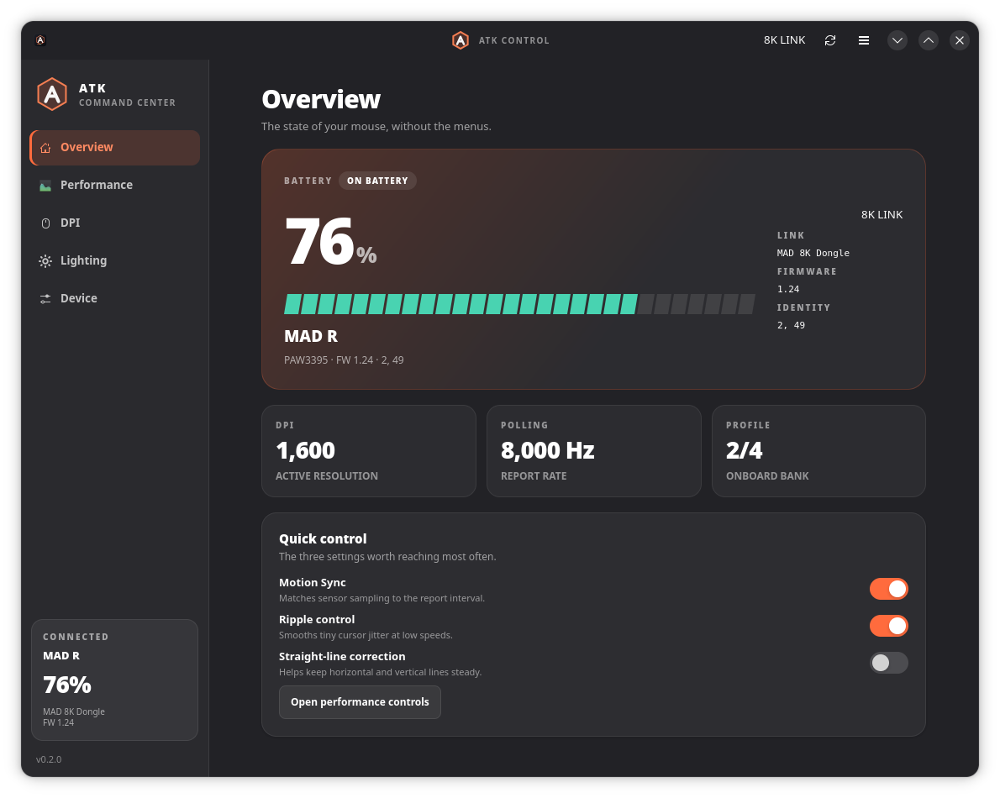
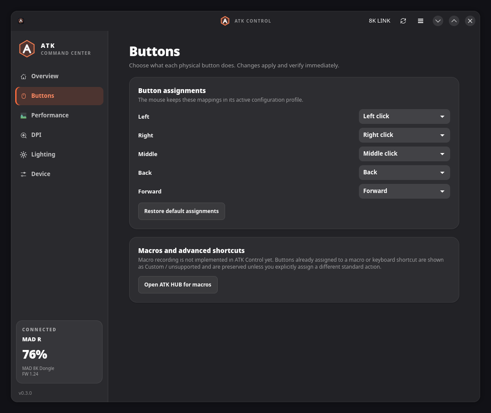
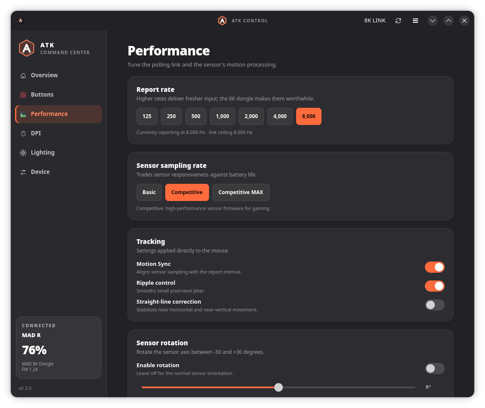
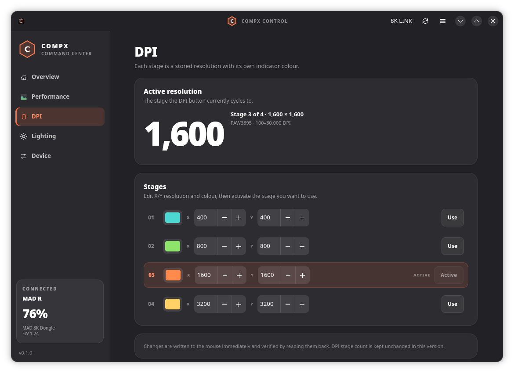
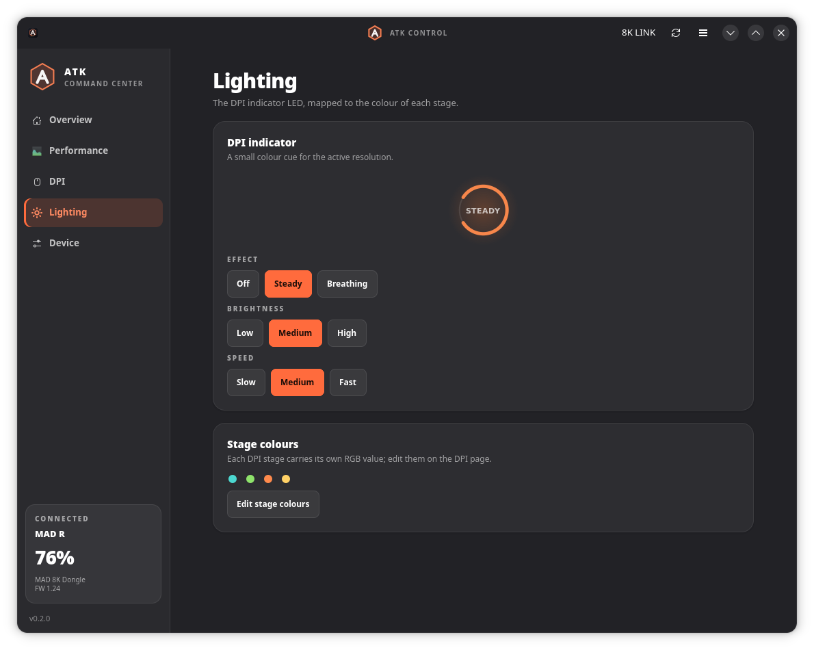
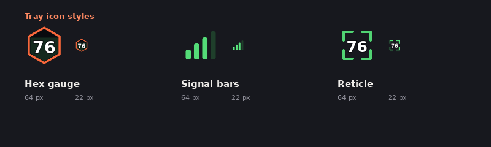
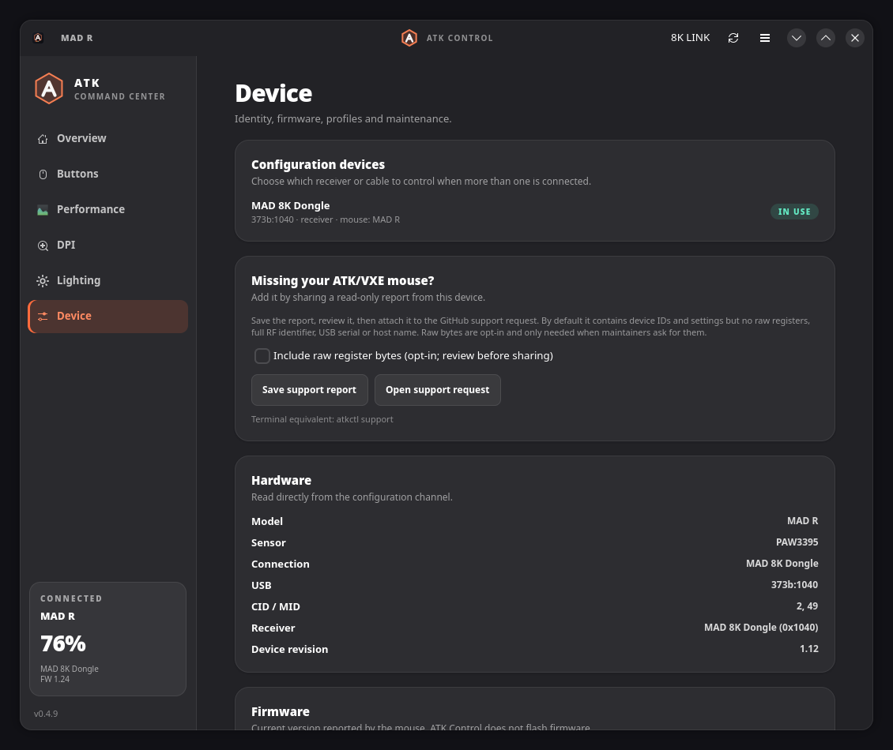

<p align="center">
  
</p>

<h1 align="center">ATK Control</h1>

<p align="center">
  <strong>Native GTK4 control centre for ATK and VXE gaming mice.</strong><br>
  DPI, polling, buttons, lighting and onboard profiles on Linux, with a live
  battery tray and a scriptable CLI.
</p>

<p align="center">
  <a href="https://github.com/NasirA1991/atk-control/actions/workflows/ci.yml"></a>
  <a href="https://github.com/NasirA1991/atk-control/releases/latest"></a>
  <a href="https://aur.archlinux.org/packages/atk-control"></a>
  <a href="https://aur.archlinux.org/packages/atk-control-git"></a>
  <a href="LICENSE"></a>
</p>

ATK Control is an independent, local-first desktop app for ATK and VXE mice.
It talks to the vendor HID interface directly, writing settings to the mouse
instead of a browser profile. There is no account, telemetry, network client or
root daemon. It is a native alternative to ATK HUB for everyday settings, with
a tray battery indicator and CLI; ATK HUB remains the vendor tool for firmware
and the features under [Limitations](#limitations).

## Contents

- [Supported hardware](#supported-hardware) · [Quick start](#quick-start) · [Features](#features) · [Screenshots](#screenshots)
- [Getting started](#getting-started) · [CLI](#cli) · [Limitations](#limitations) · [Security and permissions](#security-and-permissions)
- [Troubleshooting](#troubleshooting) · [Device reports](#device-reports) · [Documentation](#documentation)
- [Contributing](#contributing) · [License and project information](#license-and-project-information)

## Supported hardware

Only models tested on physical hardware count as verified; a family name does
not mean every variant has been tested.

### Tested hardware

| Device | Receiver | Status |
| --- | --- | --- |
| **ATK MAD R+** | 8K | **Verified** |
| **VXE R1 Pro** | 1K, 4K | **Verified** |
| **ATK Dragonfly A9 Pro Max 2.0** | Wired, 8K dongle | **Experimental** |
| **ATK A9 Ultimate** | Wired, 8K dongle | **Experimental** |
| **VXE R1 NK (NearLink)** | 1K receiver, cable | **Experimental** |
| **VXE R1 SE+** | 1K | **Experimental** |

**Verified** = every advertised setting tested on that exact model, with the
evidence recorded in the protocol notes; **Experimental** = implemented from an
owner's report and the family's proven transport, writes enabled and verified by
read-back, but not yet tested control by control. The checks behind each state
are in [Testing a mouse](docs/TESTING.md#promotion-criteria).

The Dragonfly A9 Pro Max 2.0 uses USB `373b:11dc` (8K dongle) or `373b:1264`
(wired); its owner confirmed that settings work and persist across a power cycle
on both links, but the control-by-control test is still pending, and it has no
rotation, stage-count changes or Bluetooth configuration. The A9 Ultimate
answers CID/MID `1,3` on the older `0xFF02` protocol with a PAW3950Ultra; the
lift-off level its firmware stores is still unmapped. The VXE R1 NK answers
CID/MID `2,8` over `0xFF05` and is wired/1K only. The VXE R1 SE+ answers CID/MID
`2,31` over `0xFF02` on its 1K receiver (`373b:1085`); it was added from a device
report and has not been write-tested by its owner yet.

### Other recognized hardware

| Hardware | Status | Notes |
| --- | --- | --- |
| Other MAD R family models (MAD R, MAD R MAJOR, MAD R MAJOR+) | Recognized | Not individually tested |
| Other VXE R1 family models (R1, R1 Pro Max) | Recognized | Not individually tested |
| ATK X1 Pro Max, ATK A9 Plus NearLink, VXE R1 Ultra | Recognized | Not individually tested |
| 25 additional ATK/VXE models | **Read-only** | Model and sensor recognized; writes disabled until verified |
| Other ATK/VXE mice | **Read-only** | Discovery reports only |

**Recognized** models use a model entry; some controls may be unavailable.
**Read-only** models can be identified and reported, but writes are blocked.
The catalog covers selected F1, X1, Z1, U2, A9, VXE R1 SE/R1S+, V3 and X3 models.

Receiver ceilings: 1K = 1000 Hz, VXE 4K = 4000 Hz, MAD 8K = 8000 Hz. Polling is
capped at the link ceiling; run `atkctl caps` or open the Device page for values.

Missing your model or a broken setting? Send a [device support report](#device-reports).

## Quick start

**AUR (Arch):** `paru -S atk-control` or `yay -S atk-control`; `atk-control-git` for development.

**Flatpak:** download from the [latest release](https://github.com/NasirA1991/atk-control/releases/latest), then:

```bash
flatpak install --user ./atk-control-0.9.4-x86_64.flatpak
flatpak run io.github.atkcontrol.AtkControl
```

**AppImage:** download, then:

```bash
chmod +x atk-control-0.9.4-x86_64.AppImage
./atk-control-0.9.4-x86_64.AppImage
```

AUR installs the udev rule; Flatpak, AppImage and per-user installs need the
[host udev rule](docs/INSTALLATION.md#hid-permissions) once. See
[Installation](docs/INSTALLATION.md) for dependencies and uninstalling; `pip` is not supported.

## Features

- **DPI and polling.** X/Y DPI stages, the active stage, and a report rate
  within the receiver and sensor limits.
- **Sensor controls.** Lift-off distance, debounce, sleep timer, Motion Sync,
  ripple control, straight-line correction and rotation where supported.
- **Sensor modes.** Basic, Competitive and Competitive MAX where the firmware
  allows them. Competitive MAX 13K is read-only.
- **Buttons.** Remap the five main buttons plus the optional bottom button, or
  restore defaults.
- **Lighting and profiles.** DPI indicator off/steady/breathing; four onboard
  profile banks where supported. The experimental A9 writes to its active
  profile directly.
- **Tray and CLI.** Live battery, charging, quick DPI/profile changes and
  receiver switching; `atkctl` covers every supported setting without GTK.
- **Native and safe.** GTK4/libadwaita, with the main window created only when
  opened. Writes are verified by read-back; unknown models stay read-only.

## Screenshots

| Overview | Buttons |
| --- | --- |
|  |  |
| **Performance** | **DPI** |
|  |  |
| **Lighting** | **Tray styles** |
|  |  |

<sub>Demo data; labels and controls vary by model and firmware. The tray item is hidden when no mouse is connected.</sub>

## Getting started

Start from your application menu, or run `atk-control`.

The first supported mouse is selected automatically. Use the **Device** page to
choose a receiver when more than one is connected; ATK Control can fail over to
another connected mouse when the selected one goes offline.

The window can be closed to the tray. Use the tray menu to reopen it, refresh
the device or quit. `atk-control --no-tray` runs without a tray host, and
`atk-control --tray` starts hidden where the desktop supports it. On GNOME you
need a StatusNotifier/AppIndicator extension; see
[Troubleshooting](docs/TROUBLESHOOTING.md#the-tray-icon-is-missing).

## CLI

`atkctl` is the headless counterpart for keybinds, status bars and scripts:

```bash
atkctl status                 # model, battery, DPI, polling and sensor state
atkctl battery                # percentage, charging and voltage
atkctl dpi 1600 --stage 2     # set a DPI stage
atkctl polling 1000           # set the report rate
atkctl button 3 middle        # remap a button
atkctl support                # save a sanitized support report
```

Run `atkctl --help` or see the [CLI reference](docs/CLI.md) for every command,
JSON output and exit codes. The GUI and CLI share a per-device lock; stop
`atkctl watch` before opening the app and do not run two writers against one mouse.

## Limitations

- Support is model-specific; a family name does not mean every variant has been
  verified on hardware. Polling is capped by the receiver and model; see
  [Supported hardware](#supported-hardware).
- The ATK A9 Pro Max 2.0 and VXE R1 NK `0xFF05` paths are experimental. They
  have no rotation control and no way to add or remove stages. Settings work
  over the dongle or USB cable; Bluetooth exposes no configuration interface.
- The ATK A9 Ultimate is experimental: its `0xFF02` register layout matches the
  rest of the family and the PAW3950Ultra sensor comes from ATK HUB's own model
  table, but no owner has confirmed settings on hardware yet. Its lift-off level
  (`6`) is not in the known 1 mm / 2 mm map.
- For `0xFF05` mice the lift-off byte is a vendor level, not millimetres. Levels
  1-3 map to 1 mm / 2 mm / 0.7 mm; an unmapped level is shown as
  `Lift-off: level N (unmapped)` instead of claiming a distance.
- The VXE R1 NK has no lighting, stage colours or performance-mode hardware.
- Some known models are recognized but read-only until their transport is
  verified. Experimental catalog entries never write.
- Firmware flashing is not implemented. Use [ATK HUB](https://hub.atk.pro) for
  firmware updates.
- Macro recording, keyboard-shortcut assignment, config import/export,
  receiver pairing and factory reset are not implemented. Existing assignments
  are preserved and shown as unsupported.
- Competitive MAX 13K sensor mode can be read but not selected.
- ATK Control does not require root and should not be run as root.

## Security and permissions

ATK Control has no network client, telemetry or account and does not upload
settings or reports. Preferences live in `~/.config/atk-control/` with mode
`0600`; ATK HUB or the support page opens only when you choose those buttons.

Writing settings requires read/write access to the mouse's hidraw node. The
project ships a udev rule granting the active local user access through
`uaccess`; it matches vendor IDs `373b` and `3554`, so it is intentionally
broader than one product ID. AUR and system `install.sh` install it; Flatpak,
AppImage and per-user installs need the
[host udev rule](docs/INSTALLATION.md#hid-permissions) once. Do not run with
`sudo` or `chmod 777` the device.

Writes are validated and read back. v1 settings use a profile round-trip
(roughly 0.4 seconds) and restore the original profile if it fails. Button
reset keeps a recovery copy; unknown/read-only models reject writes; the GUI
and CLI share a per-device lock.

**Privacy.** Support reports contain the model, USB IDs, firmware, link state,
readable settings, button map and sanitized system details. RF/USB serials,
hostnames and paths are redacted by default. Raw register bytes are opt-in and
are never uploaded automatically. Read
[Device support reports](docs/DEVICE_REPORTS.md) before sharing one.

## Troubleshooting

| Problem | Where to look |
| --- | --- |
| Mouse not detected, or the receiver says the mouse is asleep | [Detection](docs/TROUBLESHOOTING.md#the-mouse-is-not-detected) |
| `permission denied` on `/dev/hidraw*` | [Permissions](docs/TROUBLESHOOTING.md#permission-denied) |
| “Another ATK Control instance is configuring this mouse” | [Device lock](docs/TROUBLESHOOTING.md#another-process-owns-the-mouse) |
| Tray icon missing or not updating | [Tray](docs/TROUBLESHOOTING.md#the-tray-icon-is-missing) |
| Settings revert after a power cycle | [Persistence](docs/TROUBLESHOOTING.md#settings-do-not-persist) |
| Writes are rejected or controls are disabled | [Read-only models](docs/TROUBLESHOOTING.md#writes-are-rejected) |
| Flatpak or AppImage does not start | [Packaging](docs/TROUBLESHOOTING.md#flatpak-or-appimage-problems) |

For a reproducible log, run `atk-control --debug` or `atkctl --debug status`.
The full guide is in [Troubleshooting](docs/TROUBLESHOOTING.md).

## Device reports

If your mouse is missing, detected but read-only, or a setting does not work:

1. Open **Device → Save support report**, or run `atkctl support`.
2. Review the local, redacted file.
3. Attach it to the [device report issue](https://github.com/NasirA1991/atk-control/issues/new)
   with the model, USB IDs and receiver type.

If no configuration interface opens, ATK Control writes a **discovery report**
listing every ATK/VXE interface, usage page, report ID and descriptor without
enabling writes. `atkctl scan --all` shows the same candidates in the terminal.
Raw registers are opt-in (`atkctl support --raw`); use them only when asked.
See [Device support reports](docs/DEVICE_REPORTS.md) for contents and privacy.



## Documentation

| Document | Contents |
| --- | --- |
| [Documentation index](docs/README.md) | All guides, grouped for users and contributors |
| [Installation](docs/INSTALLATION.md) | AUR, Flatpak, AppImage, source, dependencies, udev and uninstall |
| [CLI reference](docs/CLI.md) | Every command, JSON output, exit codes and scripting examples |
| [Troubleshooting](docs/TROUBLESHOOTING.md) | Detection, permissions, tray, persistence and packaging problems |
| [Device support reports](docs/DEVICE_REPORTS.md) | What to send, what is redacted and how to open a support request |
| [Testing a mouse](docs/TESTING.md) | Verify a supported model: read-only script, reversible write checks, WSL2 caveat |
| [Protocol notes](docs/PROTOCOL.md) | v1 and v2 hardware protocol, registers and evidence (maintainers) |
| [Contributing](CONTRIBUTING.md) | Development setup, tests and pull requests |
| [Security](SECURITY.md) | Permission scope, local-only design and reporting vulnerabilities |

## Contributing

Bug reports, hardware reports and focused pull requests are welcome. For device
support, include a sanitized report and state what was physically tested. For
code, run the test suite and keep unknown or unverified devices read-only.
Start with [CONTRIBUTING.md](CONTRIBUTING.md) and the
[documentation index](docs/README.md); report security issues per [SECURITY.md](SECURITY.md).

## License and project information

ATK Control is released under the [MIT License](LICENSE). It is an independent
community project and is not affiliated with ATK, VXE, MADLIONS or the ATK HUB
team.

ATK Control is developed with AI assistance. Hardware and protocol claims are
based on evidence linked in the issues and documentation; untested models are
labelled experimental or read-only rather than presented as verified. Firmware
is not modified or distributed here; use ATK HUB for firmware updates and
features not implemented in ATK Control.
